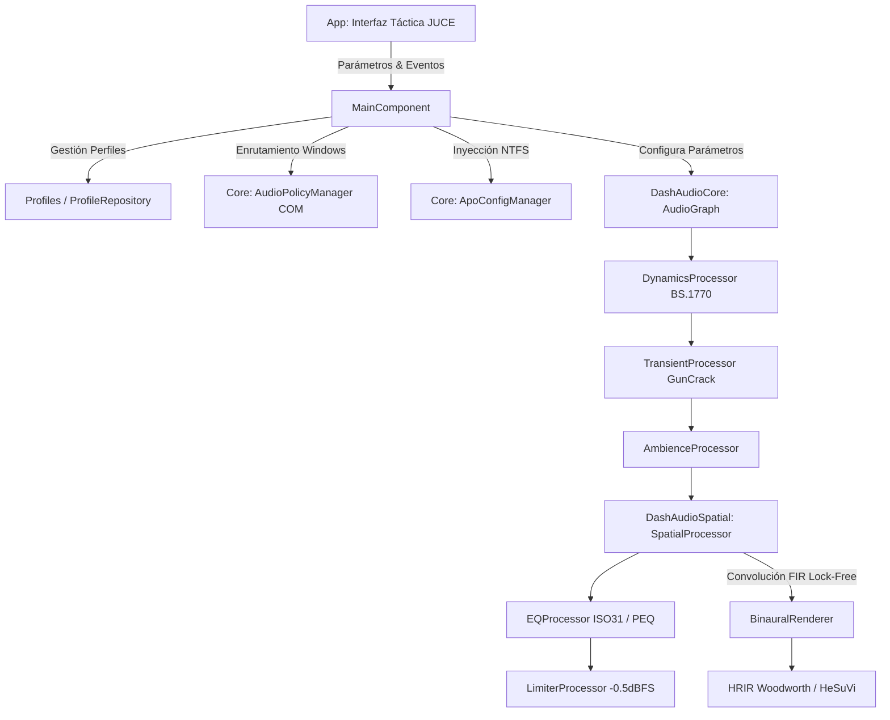

# Arquitectura del Sistema — DashCompetitivoAudio

**DashCompetitivoAudio** está estructurado en una arquitectura modular en C++20 nativo de alto rendimiento, diseñada para garantizar procesamiento de audio en tiempo real con cero latencia adicional, cero asignaciones dinámicas en el hilo de audio y separación estricta de responsabilidades.

---

## 1. Diagrama de Capas y Módulos

---

## 2. Descripción de Módulos

### `DashAudioCore`
Biblioteca estática central de procesamiento DSP multicanal (hasta 16 canales).
- **Invariante en Tiempo Real**: Ningún procesador (`DynamicsProcessor`, `TransientProcessor`, `AmbienceProcessor`, `EQProcessor`, `LimiterProcessor`, `AudioGraph`) realiza llamadas a `malloc`, `new`, llamadas al sistema o locks de exclusión mutua en su método `process()`.
- **Estructura Planar**: Punteros directos `float* const* channelPointers` con procesamiento optimizado AVX2/SSE2.

### `DashAudioSpatial`
Motor de audio tridimensional e inmersión binaural.
- **`ChannelLayout`**: Coordenadas esféricas reales (azimut, elevación, distancia) para layouts desde 1.0 hasta 16 canales (9.1.6).
- **`ConvolutionEngine`**: Convolución directa FIR en el dominio del tiempo con intercambio lock-free de filtros mediante punteros atómicos en doble búfer.
- **`BinauralRenderer`**: Mapeo tridimensional a estéreo binaural con bypass estricto para el canal LFE (< 120 Hz) para erradicar comb-filtering.

### `App / Profiles`
Capa de configuración, validación y persistencia.
- **`ProfileValidator`**: Barrera de seguridad que valida texto crudo, prohíbe extensiones ejecutables, limita archivos a 1 MB y restringe identificadores a slugs alfanuméricos seguros contra Path Traversal.
- **`ProfileSerializer`**: Serialización estricta mediante `juce::JSON`.

### `App / Core (Integración Windows)`
- **`AudioPolicyManager`**: Invocación COM binaria directa a `IPolicyConfig::SetDefaultEndpoint` para conmutar los roles de consola y multimedia sin reiniciar el sistema operativo.
- **`ApoConfigManager`**: Inyección atómica no destructiva mediante directiva `Include "DashCompetitivoAudio.txt"` en el `config.txt` de Equalizer APO.
